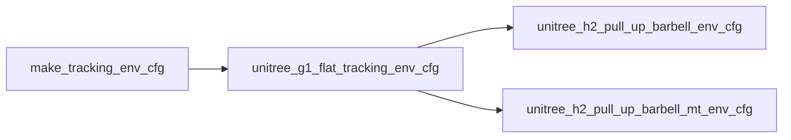

# weight_lifter_H2 与 unitree_g1_flat_tracking_env_cfg 的差异

本文档整理 `src/tasks/weight_lifter_H2`（以及其无相机变体 `weight_lifter_H2_blind`）
与其继承的基础配置 `unitree_g1_flat_tracking_env_cfg` 之间的全部差异。

## 继承关系

- `unitree_h2_pull_up_barbell_env_cfg` / `unitree_h2_pull_up_barbell_mt_env_cfg`
  均以 `has_state_estimation=True` 调用 `unitree_g1_flat_tracking_env_cfg`。
- 由于 `has_state_estimation=True`，G1 层不会裁剪 actor 观察。
- 基础 `make_tracking_env_cfg()` 中 `base_lin_vel` 与 `motion_anchor_pos_b`
  本就被注释掉，因此 H2 里对应的两行 `pop(...)` 实际为 no-op（防御性代码）。

## 1. 场景 / 仿真 / 动作 / 命令

| 项 | 继承的 G1 | H2 |
|---|---|---|
| robot 实体 | `get_g1_robot_cfg()` | `get_h2_o6_robot_cfg()`（53 自由度） |
| 新增实体 | 无 | `barbell = get_barbell_cfg()`（shaft 直径随机 0.024~0.031） |
| `sim.nconmax` | 35 | 42 |
| action scale | `G1_ACTION_SCALE` | `H2_O6_ACTION_SCALE`（手部关节 scale 覆写为 XML `max_range`） |
| command 类型 | `MotionCommandCfg` | `MotionBarbellCommandCfg`（新增 `box_xy_noise_range=(0,0)`） |
| `sampling_mode` | 默认 `adaptive`（play 时 `start`） | 强制 `uniform`（含 play） |
| `motion_file` | 空（待覆写） | `1_h2o6_pro.npz` / `1_h2o6_prosquat.npz` |
| `body_names` | G1 固定 14 个 body | H2 全部 body（`Entity.body_names`） |

`MotionBarbellCommand` 额外覆盖：

- `_uniform_sampling`：从 `candidate_frames=[0,0,150,150,150]` 随机采样，
  frame 0 概率 2/5、frame 150 概率 3/5。
- `_resample_command`：非抓握阶段把杠铃前移 0.61 m 并下降 0.81 m；
  `time_step == 150`（深蹲帧）时抬升 0.56 m。
- 新增 `graping` 属性（`200 < time_steps < 528`）、`bellbar_vector`、
  `left/right_hand_plate_vector` 等。

## 2. Actor 观察（无实际差异）

继承的 6 项，H2 未增删：

`command`、`motion_anchor_ori_b`、`base_ang_vel`、`joint_pos`、`joint_vel`、`actions`

## 3. Critic 观察（新增 4 项）

继承的 10 项：

`command`、`motion_anchor_pos_b`、`motion_anchor_ori_b`、`body_pos`、`body_ori`、
`base_lin_vel`、`base_ang_vel`、`joint_pos`、`joint_vel`、`actions`

H2 新增 4 项（只加在 critic）：

| 新增项 | 函数 | 内容 |
|---|---|---|
| `barbell_qpos` | `barbell_qpos` | 杠铃 `root_com_pose_w`（7 维：xyz + quat） |
| `bellbar_vector` | `bellbar_vector` | `plate_left − plate_right` 向量（3 维） |
| `left_hand_plate_vector` | `left_hand_plate_vector` | `plate_left − 左手抓取点`（3 维） |
| `right_hand_plate_vector` | `right_hand_plate_vector` | `右手抓取点 − plate_right`（3 维） |

另外 `body_pos` / `body_ori` 项本身不变，但其维度随 `body_names`
从 G1 的 14 个变成 H2 全部 body。

## 4. 深度相机观察组（仅 weight_lifter_H2，blind 版本已移除）

- 第一个函数：`deploy_h2_depth_camera_to` → `AdvancedCameraSensor`
  （回放真实深度视频 `.pt`），挂 `head_yaw_link`，fovy=50，分辨率 76×54。
- 第二个函数：`deploy_depth_camera_to` → 标准 MuJoCo 相机，
  挂 `torso_link`，fovy=55.2，分辨率 27×48。
- 两者都新增独立观察组 `depth_camera`（既不属于 actor 也不属于 critic）。

## 5. Events 差异

| Event | 变化 |
|---|---|
| `foot_friction` | geom_names：`^(left\|right)_foot[1-7]_collision$` → `^(left\|right)_foot_collision$` |
| `base_com` | body_names 重复设为 `("torso_link",)`，与 G1 相同（无实际变化） |
| `randomize_depth_camera_pose` | 仅第一个函数新增（`mode="reset"`）。`randomize.py` 中旋转部分被注释，实际只随机位置 |
| `push_robot` | play 模式被 pop（继承自 G1，非 H2 特有） |

## 6. Rewards 差异

实际生效的奖励 = 继承的 9 个基础奖励，H2 没有新增任何生效奖励，
所有自定义奖励均被注释掉。

继承的 9 个（均来自 `mjlab.tasks.tracking.mdp.rewards`）：

`motion_global_root_pos`(0.5)、`motion_global_root_ori`(0.5)、`motion_body_pos`(1.0)、
`motion_body_ori`(1.0)、`motion_body_lin_vel`(1.0)、`motion_body_ang_vel`(1.0)、
`action_rate_l2`(−0.1)、`joint_limit`(−10.0)、`self_collisions`(−10.0)

> `self_collisions` 依赖 `self_collision` 传感器匹配 `pelvis` 子树，H2 也有 `pelvis` body，兼容。

### 注释掉的自定义奖励实现（`rewards.py`）

| 键 | 函数 | 实现 |
|---|---|---|
| `reward_barbell_z` | `barbell_reward_hands_height` | 手 z 与杠铃 z 距离：$\exp(-\lVert \text{hand}_z - \text{bar}_z \rVert)$。该函数被定义了两次，第二个（`body_names`）覆盖第一个（`joint_names` 索引 body，有 bug） |
| `pently_hands_parrel` | `pently_hands_parrel` | 左右手 span 向量与杠铃向量的夹角之和（弧度） |
| `left/right_hand_grap_bar` | `cos_theta_minus_theta` × `graping` | 实际返回 $-\sin\theta$（θ 被 clip 到 $[0,\pi/2]$），函数名有误导 |
| `both_hands_grip_bar` | `both_hands_grip_bar_reward` | 杠铃轴两端 ±0.25 处设目标点，更远手距离 $\exp(-(d/0.10)^2)$ |
| `fingers_barbell_contact` | `fingers_barbell_contact_reward` | 左右手指接触 found 比例均值 + 0.5×双手同时接触，150~528 帧 |
| `fingers_barbell_contact_penalty` | `fingers_barbell_contact_penalty` | $\text{relu}(0.25 - 接触比例)$ 左右之和，150~528 帧 |
| `finger_dof_tracking_penalty` | `finger_dof_tracking_error` | 手指关节 MSE，150~512 帧 |
| `fingers_grip_bar` | `fingers_grip_bar_reward` | 16 根手指到杠铃轴最近点距离的 $\exp(-(d/0.05)^2)$ 均值，150~512 帧 |
| `lower_body_tracking` | `lower_body_dof_tracking_error_no_ankle` | 下肢 8 关节（不含踝）MSE，200 帧后 |
| `lower_body_tracking_after_lift` | `lower_body_dof_tracking_error` | 下肢 12 关节（含踝）MSE，350 帧后 |
| `root_z_tracking` | `root_z_tracking_error` | anchor z 平方误差，220 帧后 |
| `barbell_height` | `barbell_height_reward` | 直接返回杠铃 z，220~400 帧 |
| `hands_barbell_height_error` | `hands_barbell_height_error` | 左右手与杠铃高度差取 worst 再平方，150 帧后 |
| `knee_barbell_contact_penalty` | `knee_barbell_contact_penalty` | 膝盖接触杠铃力 > 1e-6 则为 1.0 |
| `knee_dof_tracking` | `knee_dof_tracking_error` | 双膝 MSE |

## 7. Terminations 差异

实际生效 = 继承的 4 个：

`time_out`、`anchor_pos`(threshold=0.25)、`anchor_ori`(threshold=0.8)、
`ee_body_pos`(threshold=0.25)

- `ee_body_pos` 的 `body_names` 仍沿用 G1 的
  `(left/right_ankle_roll_link, left/right_wrist_yaw_link)`，H2 未重新设置
  （当前 H2 恰好也有这些 body 名，兼容，但属隐性依赖）。
- play 模式：H2 只保留 `time_out`（H2 特有行为，G1 的 play 模式不删除 termination）。

### 注释掉的自定义终止条件（`terminations.py`）

`bad_anchor_pos`（全轴 abs 差 > 阈值）、`barbell_droped_from_hands`
（手-杠铃 z 差 > 0.1 且 `graping`）、`far_away_from_root`
（root_com 与杠铃 xy 均值距离 > 0.6）、`knee_barbell_contact`
（膝盖接触杠铃力 > 1e-6）、`bad_lower_body_dof`（下肢 8 关节任一偏差 > 1.0）、
`knee_ground_contact`（mt 函数，膝盖接触地面）、`bad_hands_dof`
（手部关节偏差 > π/6）、`bad_finger_dof`（手指偏差 > 0.5 且 `graping`）。

## 8. 传感器差异

- 继承：`self_collision`（匹配 pelvis 子树）。
- 第一个函数新增：`knee_barbell_contact`（knee body vs `shaft_collision`）、
  `left/right_finger_barbell_contact`（手指碰撞体 vs `shaft_collision`）。
- 第二个函数新增：`knee_ground_contact`（knee 子树 vs terrain）。
- 深度相机传感器（见第 4 节，blind 版本已移除）。

## 9. 潜在问题

1. `barbell_reward_hands_height` 被定义两次，第二个覆盖第一个；第一个用
   `find_joints` 拿到关节 index 却去索引 `body_link_pos_w`，是错误实现。
2. `cos_theta_minus_theta` 实际返回 $-\sin\theta$，与函数名/注释不符。
3. `barbell_lift_reward` 使用 `command.time_step`（单数），其余函数用
   `time_steps`（复数）——若启用会报错（当前被注释）。
4. `commands.py` 的 `_debug_vis_impl` 使用 `np`，依赖
   `from mjlab.tasks.tracking.mdp.commands import *` 泄漏的 `numpy`，
   未显式 `import numpy as np`。
5. `observation.py` 的 `motion_anchor_pos_b_ref` / `motion_anchor_ori_b_ref`
   已定义但当前 env_cfgs 未引用。
